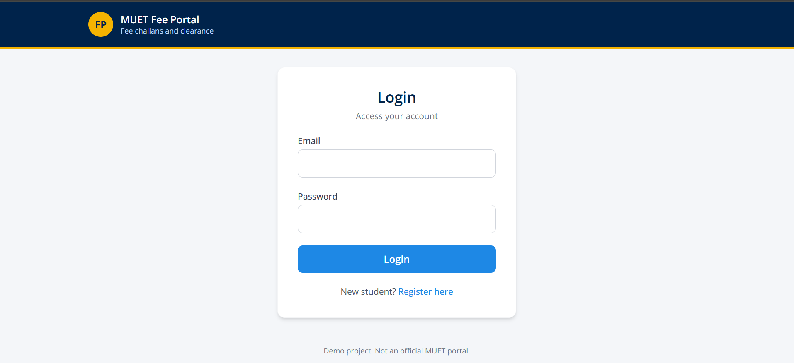
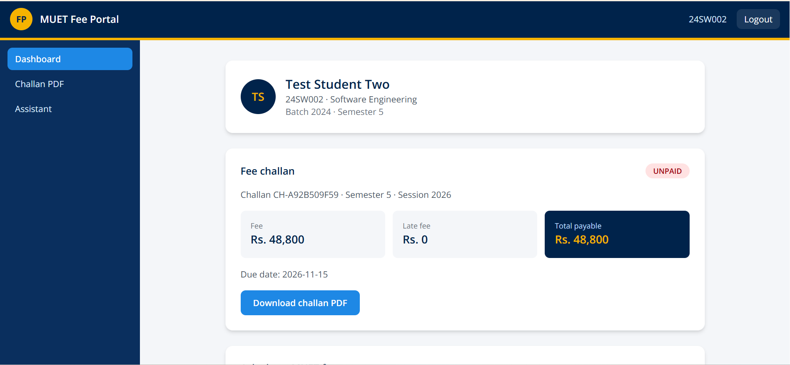
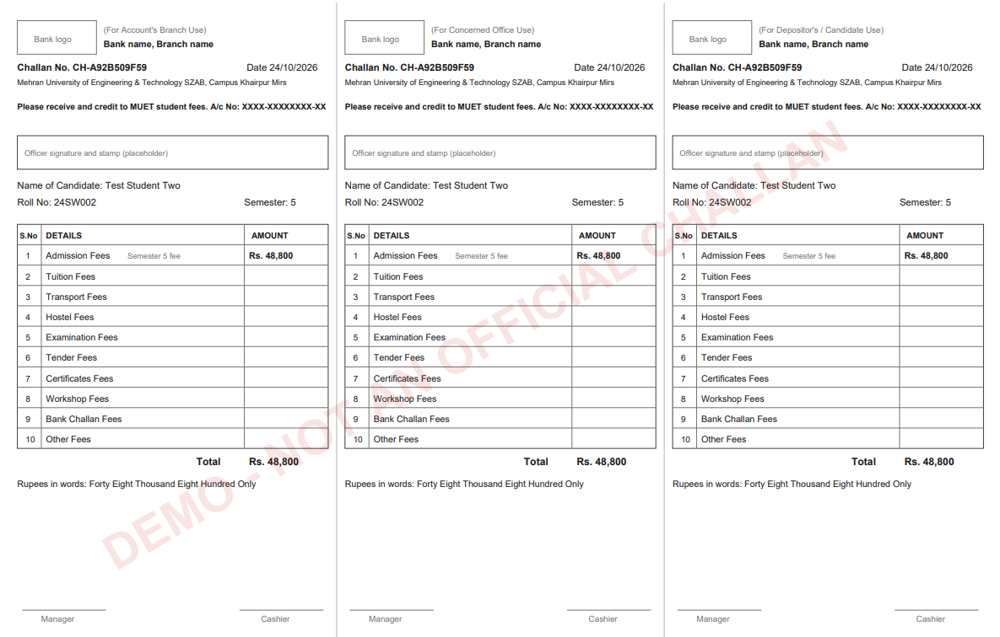
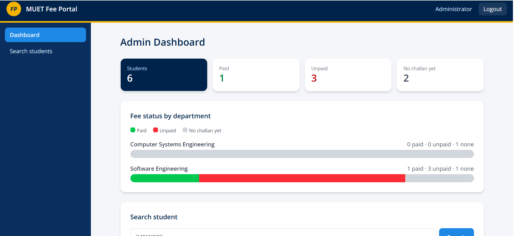
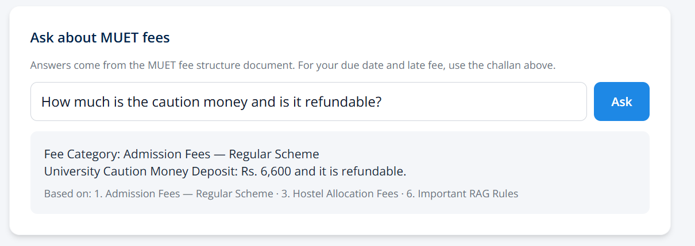

# MUET Fee Portal

A fee challan and clearance portal prototype for MUET SZAB Campus, with an AI assistant that answers fee questions from official fee documents.

> **Status:** working prototype. It is not an official MUET system. All students, accounts and amounts in the demo database are fictional, and challans carry a "DEMO" watermark until the university approves the system.

**Live demo:** https://muet-fee-portal-psi.vercel.app (demo accounts available on request)

## Why this project

Fee challans are filled in by hand in three copies, and clearance depends on someone checking whether a challan was paid. This portal digitises that flow: students download a ready-made challan, the accounts office marks it as paid, and the admin sees department-wise status and clearance at a glance.

## Features

**Students**
- Register with roll number and official email, verified against a student list uploaded by the admin
- Email verification link (Gmail SMTP)
- Dashboard with batch, semester, fee, late fee, total payable and status
- Challan PDF in the familiar three-copy layout (Account's Branch, Concerned Office, Candidate), with rupees in words
- AI assistant that answers fee questions in English or Roman Urdu, with the source section shown

**Accounts office**
- Search a challan by number and mark it as paid, with an audit log entry

**Admin**
- Department-wise paid / unpaid / no-challan charts
- Student search with clearance check

## Screenshots

| Login | Student dashboard |
|---|---|
|  |  |

| Challan PDF | Admin dashboard |
|---|---|
|  |  |

| AI assistant |
|---|
|  |

## Tech stack

- **App:** Next.js 15 (App Router), TypeScript, Tailwind CSS
- **Database:** PostgreSQL on Supabase, Prisma ORM
- **Auth:** email + password (bcrypt), signed JWT in an httpOnly cookie, role-based access (student, accounts, admin)
- **PDF:** pdf-lib
- **Email:** Nodemailer with Gmail SMTP
- **AI assistant:** FastAPI (Python) service with Gemini embeddings and generation, deployed as a separate project
- **Hosting:** Vercel (app and Python service)

## How the AI assistant works

1. The MUET fee structure PDF is split into sections and each section is embedded with Gemini.
2. For each question, the question is embedded and the three closest sections are retrieved.
3. Gemini answers using only those sections. If the answer is not in them, it says so and points the student to the accounts office.
4. The Next.js app calls the Python service with a shared secret, so only the app can use it.

## Design decisions

- **Numbers do not come from the AI.** Due dates and late fees are calculated in code from the database, never generated by the model, so a student cannot be told a wrong amount.
- **The assistant refuses to guess.** Policies that are not in the documents (late fee rules, last date, clearance) get a "ask the accounts office" answer.
- **Rate limits live in the database,** because serverless instances do not share memory. Login is limited per email and IP, the assistant per user and per day.
- **Row Level Security is on** for all Supabase tables, and the app talks to the database only through Prisma on the server.
- **Secrets stay out of the repo.** Verification tokens are stored hashed, and the Python service rejects calls without the shared secret.
- **The fee structure is replaceable.** Batch-wise fees and extra policy documents can be added once the university provides the real data.

## Run it locally

Requirements: Node 20+, Python 3.11+, a PostgreSQL database (Supabase works), a Gemini API key and a Gmail app password.

```bash
npm install
cp .env.example .env     # then fill in the values
npx prisma migrate deploy
npx prisma db seed
npm run dev
```

The Python service:

```bash
cd rag-service
python -m venv .venv
.venv\Scripts\activate          # Windows (use source .venv/bin/activate on Mac/Linux)
pip install -r requirements.txt
python build_index.py           # builds index.json from docs/
uvicorn main:app --reload --port 8000
```

Environment variables (names only):

- App: `DATABASE_URL`, `DIRECT_URL`, `JWT_SECRET`, `SMTP_USER`, `SMTP_PASS`, `APP_URL`, `RAG_URL`, `RAG_SECRET`, `SEED_PASSWORD`
- Python service: `GEMINI_API_KEY`, `RAG_SECRET`

## Roadmap

- Real student list and batch-wise fees after university approval
- Bank name, branch, account number and logo on the challan (placeholders are in place)
- More policy documents for the assistant (admissions, exams, hostel rules)
- A custom domain for better email delivery

## Author

Zulqernain Maher, Software Engineering student at MUET SZAB Campus.